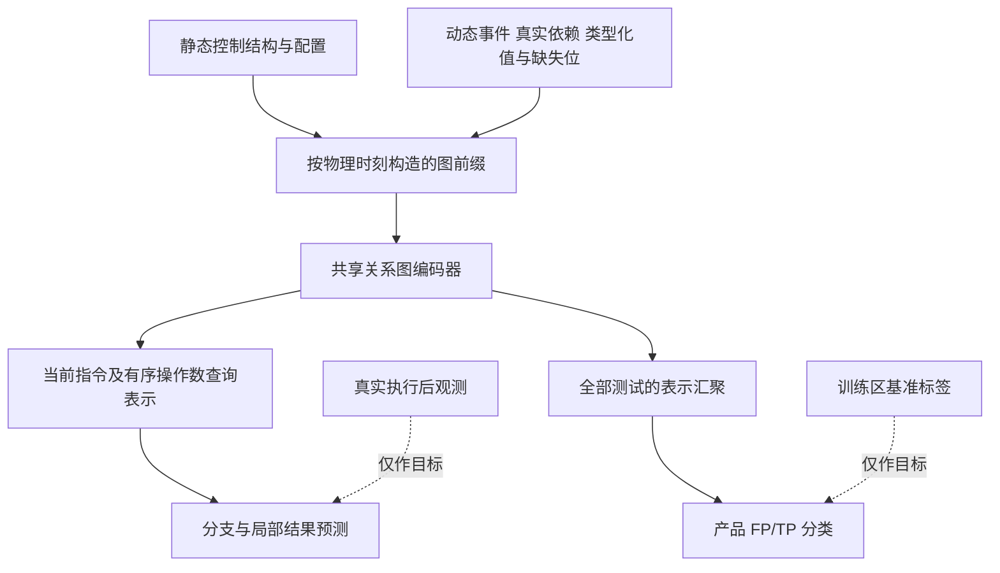

# CWM-FP 四系统单缺陷统一模型与算法设计

设计版本：`cwm_fp_design_v1`。2026-11-02。范围为 BankAccountTP、Email、Elevator、ExamDB 的单缺陷案例。本轮完成理论分析、模型与实验设计，以及版本控制接入；没有修改标签、冻结划分或历史结果，没有进行新采集和训练。下文标为“设计”的模块与协议仍须实现和验收。

核心决定：使用**具有程序依赖约束的可观测执行上下文表示**，同时服务于产品分类和局部转换辅助学习。第一版不默认增加循环记忆网络，不把下一步预测误差当作缺陷分数，不把观测依赖图称为已识别的干预因果图。研究是否成功，以四系统协议下的产品级识别增益为准。

## 1. 研究对象和需要回答的问题

对一个产品，在指定测试套件已经全部通过后，预测它在基准定义下是假通过 FP，还是真通过 TP。原始失败产品 F 不属于这个二分类的目标样本。标签复用 CLAP/PULP 基准标签及其既有生成规则，不要求重新设计标签或把额外人工缺陷证明作为实验前置条件。标签、版本、产品、套件视图必须正确连接；真实缺陷位置只允许在隔离的离线标签流程使用，不能进入模型特征。

本轮主视图使用原始测试套件。由删除失败测试构造的 FP 属于不同的套件视图，必须使用与标签匹配的通过子套件并封存删除的测试。该视图可作后续独立复现，不能把转换标签配给仍含原始失败测试的图，也不能以保留原始套件的结果冒称复现论文全部样本。

需要分别检验：

1. 依赖结构是否比覆盖率、手工特征或顺序表示更适合 FP/TP 识别？
2. 在**输入、分类结构、样本和预算相同**时，转换监督是否改善分类？
3. 改善能否出现在训练时未使用的缺陷版本及完整留出系统？

三者都是研究假设。转换预测准确、程序图正确、GPU 能训练，均不能单独回答这些问题。

## 2. 理论依据及适用边界

### 2.1 为什么世界模型常常使用历史状态

PlaNet 把图像控制任务建模为部分可观测过程，由过去观测和动作估计当前隐藏状态，再预测后续观测和奖励；循环结构为其记忆机制的一种实现。该论据适用于“单次观测不能充分描述当前状态”的场景，不意味着每个世界模型都必须有循环网络。[Hafner 等，2019，第2—3节](https://proceedings.mlr.press/v97/hafner19a/hafner19a.pdf)

**对本研究的推论：**程序完整状态可写为指令位置、调用栈、局部变量、操作数栈、堆及外部状态。在固定执行环境和调度等条件下，下一步遵循程序语义。日志只是这些状态的部分观测。我们需要的是“当前已知什么、什么仍未知”的表示，不必先假定一个不可解释的循环隐藏状态就是完整程序状态。

局部动态依赖图已经保存各次执行、值版本及历史定义使用。若当前预测所需的输入均可沿已知依赖得到，图前缀及显式操作数就可能足够；若存在未记录的初始化或库效果，额外循环网络也不能将缺失值变成真实观测。

因此第一版令 `z_t = E(G_pre(t), op_t, O_t, M_t, C)`，直接编码执行前图及可观测局部状态。它叫“可观测执行上下文表示”，不声称满足马尔可夫性，也不是完整堆快照。是否需要额外历史记忆，由独立对照验证。

### 2.2 为什么使用程序依赖结构

程序依赖图把数据与控制关系显式表示出来，有助于聚焦计算相关部分；这首先是程序分析结果。[Ferrante、Ottenstein、Warren，1987，第1—3节](https://www.cs.utexas.edu/~pingali/CS395T/2009fa/papers/ferrante87.pdf)

本研究借用这种结构作为学习归纳偏置：不同系统的变量名字不同，但“读取—运算—判断—写回”的组合可能共享低层程序语义。动态定义使用给出本次实际值传播，静态控制依赖给出可能的控制上下文；二者必须保留来源区别。

跨系统共享并非自动成立。相同 JVM 指令语义可共享，不等于银行与邮件的业务正确性或 FP 判别规则相同。是否能组合出可迁移的产品表示，是待实验回答的问题。

### 2.3 为什么不能直接移植因果动力学的证明

因果动力学学习 CDL 的理论建立在因果马尔可夫与忠实性、完整可观测的马尔可夫状态、特定时间边约束及条件转换分解等假设上。[Wang 等，2022，第3.3节 A1—A5](https://arxiv.org/pdf/2206.13452)

本项目有缺失状态、确定性复制、别名、未观察库效果及不同系统结构。这些条件不能自动满足上述假设；在确定性程序中，变量之间的冗余和函数约束也会使直接套用一般条件独立检验不可靠。因此不实施“删一条图边、预测变差，就证明这是真实因果边”的推断。

因果表示研究讨论以相对稳定的机制支持迁移，但这种迁移仍有假设和识别边界；观测预测与干预预测是不同问题。[Schölkopf 等，2021，第III—IV、VI节](https://arxiv.org/pdf/2102.11107)

本阶段的“因果”体现为**程序语义约束、时间可见性和作用关系先验**。正式表述为“因果结构引导的观测式局部转换模型”。保持 CWM-FP 作为研究项目名称；当前不宣称已经学习出可干预的结构因果模型。既没有真实干预对，也没有自主多步模拟的认证。

### 2.4 局部转换预测为什么可能有用，又为什么可能无效

它提供产品标签之外的真实执行监督，使共享编码器学习值如何被使用、条件如何受操作数影响。辅助任务可以改变表示，但已有理论针对特定学习场景，不能直接证明它对软件产品 FP 识别有益。[Lyle 等，2021](https://proceedings.mlr.press/v130/lyle21a.html)

本研究的假设链是：依赖约束帮助选取相关上下文 → 转换监督促使表示保留执行信息 → 产品分类从这些信息获益。必须逐项检验，不能把第一项直接等同第三项。

一个说明性例子（不是新实验）：某实现把本应减去的金额写成加法。错误程序仍然正确执行 JVM 加法；学会预测加法结果并不能证明业务逻辑正确。若测试输入恰好为零，错误与正确版本还可能给出相同输出。因而：

- “预测错误大”不等于 FP；“预测错误小”不等于 TP。
- 不把全部训练轨迹当作无缺陷的正常行为，不训练未经授权的异常检测替代标签分类。
- 已知操作码与充分操作数时，许多局部操作本来就有符号计算答案。必须保留符号参照和不使用图的操作数模型，防止把重新学会整数比较包装成研究突破。
- 若转换成绩改善而分类不改善，假设2不成立，应报告无益或负迁移，而不是继续无限扩大网络。

整数溢出、比较方向和类型规则依照 [Java 8 虚拟机指令规范第6章](https://docs.oracle.com/javase/specs/jvms/se8/html/jvms-6.html)。符号规则产生的核验值不是新增运行测量。

## 3. 问题形式化

产品 `p` 的输入为配置 `C_p`、组合程序静态结构 `S_p` 和指定套件的真实轨迹集合 `{τ_pj}`。每条轨迹保留独立执行事件与物理证据时钟。

- `G_pre(t)`：时刻 t 执行前可见的静态上下文和动态前缀。
- `op_t`：当前真实指令的精确操作码及类型。
- `O_t, M_t`：有序局部操作数及其可信/缺失掩码。
- `Y_t`：当前指令完成后可核对的分支或结果值，仅作转换目标。
- `y_p`：基准产品标签，FP=1、TP=0，仅在授权训练区监督分类。

预测形式为 `qθ(Y_t | G_pre(t), op_t, O_t, M_t, C_p)`。当前指令由程序执行决定，**不是智能体自由选择的干预动作**。本轮没有奖励函数、策略网络或强化学习。

产品输出为 `Pψ(y_p=1 | S_p,C_p,{τ_pj})`。输入若不能区分两个不同标签的产品，任何仅使用该输入的确定性分类器都不能同时正确区分二者。这是输入信息限制，不是继续增加训练轮次就能保证解决的问题。静态未执行代码上下文因此仍保留；但第一版不声称能凭未执行代码定位任何潜伏缺陷。

## 4. 输入与时间契约

### 4.1 主输入确实是局部动态依赖图及其状态属性

| 成分 | 学习字段 | 仅用于审计和连接 |
|---|---|---|
| 程序元素 | 类型、来源类别、精确操作码、静态常量的类型化数值 | 类/方法名、行号、偏移、字节码摘要 |
| 动态事件 | 操作语义、已发生关系、操作数角色 | 事件、帧、线程和测试唯一编号 |
| 值版本 | 数值类型、可信值、缺失位、观测来源 | 变量名、对象地址、原始散列、值版本ID |
| 配置 | 启用状态、已验证的特征到程序归属关系 | 系统专用特征名称和产品编号 |
| 结构 | 静态控制、真实定义使用、产生/消耗、时间、静态身份关联 | 缺陷位置、补丁、标签来源不得进入 |

不能将新系统的特征名称简单拼成系统识别码。第一版使用匿名特征节点及其启用/归属结构；未核验归属或配置约束时保留未知，报告配置消融不可用，不能把未知当关闭。原始变量、类、方法、行号、产品和缺陷版本均不做可学习身份嵌入。

整数原始存储保持有符号32位语义；模型的整数表示采用固定32位二进制补码加类型和可信掩码，不先转 float32 丢失大整数精度。未知位的载荷占位不能解释为真实零。浮点特殊值、宽整数、任意对象相等和完整对象内容在第一版数值头中关闭。真实空值仅用独立、已认证的空值标记，不用对象散列0代替。

### 4.2 时间边界

输入必须从“已到达记录”生产，不能从最终图删后半段冒充执行前输入。当前指令的结果回调、实际后继、未来消费者、最终测试结果、最终覆盖率、整图质量标志和最终长度不能进入 `G_pre(t)`。

同一源码位置的多次执行保留独立事件。跨测试不连动态边。所有边的证据可用时间不晚于查询时刻；当前操作数连接必须由当时已有栈/帧证据确定，不能从执行后的定义使用表反推。

新增的静态身份关系只表示 `static_instruction → event_instance`。默认只允许静态到动态传递，避免动态信息写回共享静态节点再传播到其他执行或测试；旧格式不重解释。静态控制边不携带尚未发生的分支结果，不自动变成动态控制边。

完整套件结束后的产品分类允许汇总已经发生的全部观测。分类监督和转换监督共用参数不构成时间泄漏；关键在于转换前向输入与其目标严格分离。分类分支得到的最终表示不得反向作为早期转换前向的输入。

### 4.3 三种资格分别判断

1. **结构资格**：身份、帧、执行顺序、所声明依赖及配对结果可信。
2. **局部转换资格**：查询的输入/目标/时刻可信，不要求完整堆，但不得跨越影响该查询的未知语义。
3. **完整产品资格**：全部登记测试保留，满足正式产品图合同；不得删除不支持测试凑齐产品。

结构可信而数值缺失时，结构可参与分类、相应数值损失关闭。结构本身未认证时，不能仅靠缺失掩码就把整图放行。局部转换即使合格，也不自动使产品合格。第一版继续遵守现有完整产品门槛；本设计没有执行门槛放宽。

## 5. 最小统一模型



### 5.1 编码器和查询

复用现有关系图网络的消息传递形式，首版固定两层、隐藏宽32，所有主要结构对照一致。不把该容量当作理论最优值。输入升级为新格式，旧22列及旧检查点保持独立版本。

静态子图先编码一次；动态子图只能使用当前已知事件。当前查询显式拼接：当前事件表示、对应静态指令表示、按消耗顺序排列的最多两个受支持操作数表示、操作码/类型及缺失位。通过显式查询读取操作数，不依赖“恰好能在两跳内到达值节点”。超过该操作数范围的指令仍保留在结构图，不静默裁掉，第一版局部数值监督关闭。

第一版没有额外 GRU、循环随机潜变量、规划或多步想象。已有完整图的分批读取与测试/产品汇聚继续复用。静态共享计算必须与独立计算等价；新增身份边后，旧05B依赖“静动态完全断开”的共享缓存不能直接沿用，需新键与等价检查。

### 5.2 转换头

- **条件分支头**：对已认证整数比较及可信空值判断输出跳转概率，使用二元交叉熵。
- **局部整数结果头**：对已认证有限整数操作输出32个结果位的概率，使用按位平均二元交叉熵；评价同时报告完整32位精确匹配率，不能只用高位大量为零获得好看的逐位准确率。按位概率只是预测头，不宣称结果位因果独立。
- 原05B的“下一事件9类预测”保留作历史/诊断对照，不再作为主方法的必要损失。
- 输出、断言和一般字段未来状态不在缺少证据时启用预测。可观测输出用于分类时也须按相同时间规则进入，不能从未来提前加入转换上下文。

当精确操作数齐备时，应同步给出 JVM 符号参照。另有不使用图的“操作码+同样操作数”预测器，用以检查图上下文是否有额外贡献。不能让图模型看到更多数值后，将收益全部归功于依赖结构。

### 5.3 产品分类头

复用测试内、产品内两级汇聚，得到一个产品输出。第一版采用均值汇聚，避免同时更改过多部件；静态上下文和真实运行事件分开汇聚后连接，避免程序越大静态节点越压倒动态证据。所有原测试保留，完整产品只产生一次分类目标。

分类仅使用编码表示和当时允许的观测，不直接使用预测误差、目标可用位或事后语义检查通过位作为缺陷分数。这样转换学习的作用来自共享编码器的训练约束，而不是未经证实的“错误越大越像缺陷”。

### 5.4 优化目标

`L_total = L_FP + λ (L_branch + L_value)`。

每项先在有效位置内平均，再按测试、产品、版本及系统逐层平均；没有该目标的测试贡献及有效分母须显式记录，不能把缺失目标记为真实0。分类只在原始通过且标签可连接的训练产品上计算。首轮联合实验使用同一批训练产品，F产品不额外加入转换预训练，以免数据增量混淆辅助任务效果；以后使用F轨迹须另列对照。

首轮固定 `λ=0.1`，不是理论推导值；`λ=0` 是核心分类对照。分支单项、数值单项分别作为预先列明的消融，不临时增加搜索。验证只按产品分类损失选择检查点，不能用更好的转换成绩选择最终分类模型。精确训练轮数、微批和执行上限在数据规模核验后、模型拟合前单独冻结，本设计不虚构吞吐或运行预算。

### 5.5 算法流程

```text
先冻结四系统产品清单、套件视图、版本分组和评价协议
只用训练区构建必要的拟合统计；基准标签独立保存
对各测试，从真实记录顺序生产前缀、局部观测和分离目标
对一个训练产品：
    遍历全部登记测试及其执行记录
    用共享编码器形成当前查询表示
    仅在局部证据合格位置累计转换损失
    保留完整测试表示并汇聚为产品表示
    连接该训练产品的基准标签，计算分类损失
    按冻结的层级权重和微批策略反向更新
只用源系统/训练版本中的验证区选择检查点
冻结模型与预测；独立评价器最后连接测试标签
输出分类、转换覆盖、拒绝覆盖及资源报告
```

以上为设计伪代码，不是已经存在的新命令或接口。旧入口不能仅修改配置名就被视为实现了本算法。

## 6. Email 与 BRFL 的实现任务如何收敛

BRFL 的图构建、栈解释、字段和调用处理继续复用。当前 `TraceTransformer` 将 `getstatic` 送入完成标记路径；`GetStaticInst` 存在读值函数并不表示实际调用了它。`GetFieldInst` 找不到历史字段节点时仍可构图；这并不产生未记录的写入证据。引用回调使用散列，不能自动作为数值或可靠对象身份。

本地核对位置：`src/main/java/ppfl/instrumentation/TraceTransformer.java`、`opcode/GetStaticInst.java`、`opcode/GetFieldInst.java`、`CallBackIndex.java`；原 BRFL 仓库只读，不纳入本仓库原样发布。

因此正确的修复目标是补足当前方法真正需要的观测，而不是实现通用虚拟机：

1. 自然发生的静态字段读取完成后记录真实类型化值。
2. 引用读取记录明确空值标志；只有任务需要对象同一性时才设计独立身份。
3. 已知当前读值但未知上游写入时，允许未来独立版本的局部观测模式从该时刻开始；不补造历史依赖、不恢复完整堆。
4. 更早未知调用可能污染帧、栈或目标状态时继续拒绝；恢复局部可信性必须有明确的状态边界证明，不能只看到一个后续数值就重启整个解释器。

既有05C-3A结果仍为0/67。本设计没有新增转换，也不承诺某次回调修复能使整个Email产品准入。Java工具链和执行配对验收可在本机完成；服务器训练环境不应成为本机预处理的默认阻碍。

## 7. 四系统实验协议

### 7.1 数据范围与标签

固定四系统单缺陷：BankAccountTP、Email、Elevator、ExamDB。新增目录核查得到 Elevator 20、ExamDB 49 个版本目录；这些是目录数，尚非本轮可训练样本测量。原两系统清单与结果保持冻结，四系统另建协议版本，不能在旧清单上追加后仍声称摘要不变。

直接复用可匹配的 CLAP/PULP 标签；如只提供标签生成材料，则在隔离输出目录调用/适配其现有规则，逐项记录与原实现差异，不改原始数据。标签匹配与来源核查不是重新标注研究。没有标签的通过产品不自动设为TP。

### 7.2 两类主评价

**按缺陷版本留出：**各系统分别按 `(system, bug_version)` 划分训练/验证/测试，再合并。设计比例70/15/15、固定种子20261102，按版本稳定散列排序和确定性配额，不依据测试标签补类。全部产品和测试继承版本归属。正式数字在清单生成后报告，不调整旧实验划分。

**整系统留出：**轮流将一个系统作为测试，其余三个系统的版本分为训练/验证（设计比例80/20）。共四个外层折，所有超参数选择、预训练、标准化、标签学习均在源系统分区；目标系统不参与参数更新。四折方法在任何目标分数返回之前冻结，不允许看完一折修改方法再将其他折当作同一实验。

模型训练隔离与研究者从未接触系统不同。BankAccountTP和Email已有开发接触，尤其Email轨迹已用于方法诊断；必须披露。四折可检验算法上的留出系统表现，不能全部称为从未接触的盲测。新增两系统的留出折在实际实验前固定，结果不得用于回头调方案。

### 7.3 基线的两种信息条件

CLAP 的属性使用当前缺陷版本中可观察的失败测试信息；PULP 也使用失败产品作为正例，而不是使用训练FP标签。论文原生设定与“目标系统没有任何参考产品”的单产品归纳设置不同。不能将所需参考信息全部禁掉、把50维填成零，再把退化成绩当作原方法无效。

因此分开报告：

- **主归纳比较：**所有学习参数只由训练区拟合。目标查询产品及其自身测试为输入；不能满足此条件的原生基线明确标为适配版或不可用，常量缺证据结果只作诊断。
- **版本上下文比较：**各方法获得相同、事先声明的目标版本原始通过/失败测试信息；不含FP/TP真值。CLAP按原定义生成属性，PULP按原有正例/无标签方式处理。这属于目标版本上下文/适应条件，不能混称为无适应的整系统留出。若CWM不使用额外上下文，也须明确说明信息利用差异。

原PULP源码与所给论文在负例采样、聚合规则上存在已记录差异；源码复现和论文公式复现分列，不静默替换。论文的跨系统汇总也不自动等于整系统留出。证据见本地两篇PDF：CLAP第10、16页，PULP第11、14—15页。

### 7.4 最小对照矩阵

| 编号 | 方法 | 主要回答的问题 |
|---|---|---|
| B1/B2 | CLAP、PULP，按上面信息条件分列 | 是否优于既有方法 |
| B3 | 覆盖率/测试统计分类器 | 是否仅利用覆盖率或套件规模捷径 |
| G0 | 结构图分类，不加新数值输入 | 复用现有图分类参照 |
| G1 | 精确语义+状态的图分类，λ=0 | 新输入本身带来多少增益 |
| G2 | 与G1相同编码器/分类头，加入分支和局部数值辅助损失 | 转换学习是否改善分类；主方法 |
| G2-b/G2-v | G2仅保留分支/数值辅助损失 | 哪个辅助任务起作用 |
| S1 | 同样精确语义与操作数的顺序模型，加同样辅助目标 | 收益是否来自依赖图而非一般顺序学习 |
| O1 | 精确操作码+同样操作数，无图的局部预测器；另列符号参照 | 局部预测是否只是在重新学习指令规则 |

G1与G2的推理分类结构完全相同；G2额外头只用于辅助训练，参数量及训练计算增量单独报告。主比较保持相同产品遍历与分类更新次数；另记录算力，不能声称计算量完全相同。额外循环记忆只列后续必要性对照，不在首轮强加到主模型。

三个训练种子固定为20261102、20261103、20261104；不挑最好种子。分类主要报告FP精确率/召回率/F1、平均精确率AP、ROC面积、平衡准确率和概率损失；转换另报覆盖率、覆盖内性能、精确操作码分层及符号参照。置信区间按缺陷版本整组重采样，不能将前缀或同版本产品当独立样本。单类折按指标定义处理，不为了补类修改测试划分。

必须同时给出：各方法完整适用队列结果、所有方法共同可用产品上的配对结果、按系统/版本/配置的采集和准入覆盖。被拒绝产品不消失，不按图是否容易处理重新抽样。不满足完整图条件的产品不能进入正式图分类，但仍可进入其本身适用的覆盖率基线。

### 7.5 研究结论的判定

- G2优于G0却不优于G1：不能把收益归因于转换学习。
- G2转换更好但产品分类不改善：世界模型辅助识别的假设未获支持。
- G2不优于同信息S1：不能声称依赖图比顺序表示更有效。
- 只在同系统有效：不能声称跨系统成立。
- 只有观测评价：不能声称反事实正确或因果效应已验证。
- 四个小型基准系统的结果不能外推为任意工业系统的保证。

## 8. 本机预处理与服务器训练

本机执行只读标签连接、源代码/字节码审计、BRFL配对采集、图与状态生产、划分及相对路径导出。服务器只接收代码提交快照、允许分区数据和冻结配置，在用户已有容器内训练。宿主机不安装实验环境。

每个数据包绑定源码、类文件、插桩器、JVM、套件、划分和字段格式摘要。Windows绝对路径只作审计，用单独路径映射迁移，不修改旧清单。训练包只开放训练输入/目标，验证与最终评价采用分离入口。测试目标在预测冻结后由评价器连接。

不承诺整图/前缀训练天然节省显存。复用无损分片、梯度累积及静态缓存时，必须验证与完整计算的输出/梯度等价；不能截断测试、事件或依赖边。训练执行预算在规模核实后冻结。本轮没有新性能、GPU显存或速度测量。

## 9. 现有实现与后续必要修改

| 现有文件 | 已有能力 | 统一设计所需修改，尚未实施 |
|---|---|---|
| `src/cwm_fp/models/graph_encoder.py` | 22列、关系传播、两级汇聚 | 新字段版本、精确操作码/类型化值、身份消息关系 |
| `src/cwm_fp/models/graph_classifier.py` | 产品二分类 | 接入统一表示，保留同结构λ=0对照 |
| `src/cwm_fp/models/transition_model.py` | 独立结构转换预测 | 共享编码器和有序操作数查询、受支持数值头 |
| `prefix_observer.py`、`prefix_reader.py` | 物理时间前缀与防未来泄漏 | 新关系/数值输入的可见性核验 |
| `field_evidence.py`及现有Java适配 | 证据分层、部分回调 | 最小字段读值补采及条件局部恢复证明 |
| `graph_package.py`、`train_graph.py` | 无损产品读取、训练入口 | 新格式封装、统一损失及公平对照 |
| `data/labels.py`、`baselines/` | 已有标签连接与两系统基线 | 四系统新清单、标签来源匹配、信息条件分列 |

不创建重复解释器，不在本轮实现新模型或改旧质量门槛。模型设计文件不是可执行训练配置；`configs/model_design_v1.json`标明这一状态。

## 10. 本轮完成情况与下一步

本轮核对了当前分类/转换代码、BRFL关键字段路径、现有标签入口及阶段报告；本地抽取两篇PDF并阅读与本任务相关的标签、数据集和实验协议章节；查阅上述原始文献的相关章节。没有声称对所有文献进行了完整复现。

完成统一模型、损失、输入/目标时刻、准入区分、四系统评价及版本控制规则设计。当前算法实现状态仍为“待接入”，原28个Bank完整产品队列和Email 0/67结果未变。本轮没有运行模型/Java测试；只执行文档、配置与发布清单检查，检查回执独立保存。

下一步按收益和依赖顺序：

1. 按本设计落实统一输入/模型接口和同信息对照，同时修复必要的字段观测；用有限验收检查共享梯度、时间边界与原执行一致性。
2. 在四系统单缺陷数据上生成独立清单、标签连接和共同评价队列，完成CLAP/PULP基线；原生上下文条件与严格归纳条件分表。
3. 将冻结代码与数据包送入服务器，先做有限训练验收，再执行预注册比较；不自动开始干预或强化学习。

## 11. 参考资料和已有证据

- PlaNet：Hafner et al., ICML 2019，上述原论文第2—3节。只支持部分观测、历史估计与转换建模的设计背景。
- CDL：Wang et al., ICML 2022，第3.3节。只在其假设下提供因果动力学识别依据，不直接证明本项目可识别。
- 因果表示：Schölkopf et al., Proceedings of the IEEE 2021，第III—IV、VI节。支持机制、迁移与因果识别边界的讨论。
- 程序依赖图：Ferrante et al., TOPLAS 1987。支持控制/数据依赖程序表示，不证明统计因果识别。
- 辅助任务：Lyle et al., AISTATS 2021。支持辅助任务影响表示的背景，不提供FP识别增益定理。
- Java 8虚拟机规范第6章。用于有限整数/比较符号语义。
- 用户提供 `references/CLAP_IST_2022.pdf` 第10、16页；`references/PULP_ISSTA_2026.pdf` 第11、14—15页。仅本地保存，未把论文全文发布到仓库。
- 本地历史证据：`outputs/phase04R1_review_packet.md`、`phase05B_review_packet.md`、`phase05C1_review_packet.md`、`phase05C3A_review_packet.md`、`baselines_reproduction.md`。历史结果只读保留，本设计没有重跑或改写。
